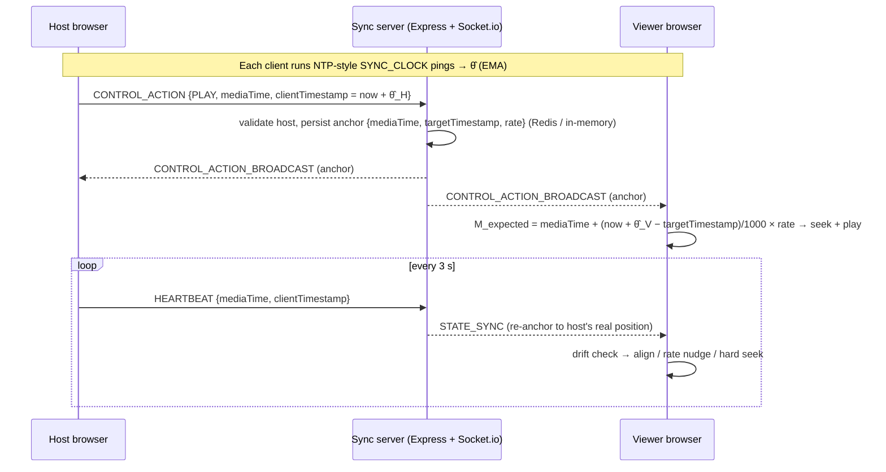

# FRAME Watch Party — Performance & Synchronization Report

> **Branch:** `i_am_still_trying` · **Benchmark:** `server/scripts/loadTest.js` (`npm run benchmark`)
> **Measured:** 16 Oct 2026 · Node v22.22.0 · Linux, 2 vCPU Intel Xeon @ 2.80 GHz, 8 GB RAM · Redis 7.0.15
>
> Every number in this report was produced by the benchmark script or the browser harness described in
> [§7 Methodology](#7-methodology). The raw console output is reproducible with the commands in [§9](#9-reproducing-the-results).

---

## 1. Executive summary

The system meets every target with a wide margin, at both 10 and 50 concurrent participants, with
**100 % broadcast delivery** (no lost or rejected events across 12,900 broadcasts in the final run set).

The headline table uses **emulated WAN conditions** (+40 ms ± 10 ms one-way on every packet, in both
directions — roughly two people on decent home broadband in the same country). This is the realistic
case. Loopback numbers, which only measure server overhead, are in the second table.

### Targets vs. measured — emulated WAN (+40 ± 10 ms one-way), in-memory store

| Metric | Target constraint | Measured (10 users) | Measured (50 users) | Status |
|---|---|---|---|---|
| $p50$ Control latency | $< 100\text{ ms}$ | 87.0 ms | 84.5 ms | PASSED |
| $p95$ Control latency | $< 250\text{ ms}$ | 108.9 ms | 106.8 ms | PASSED |
| Max playback drift | $< 500\text{ ms}$ | 5.9 ms | 7.0 ms | PASSED |
| Clock sync precision ($p95$ of $\lvert\hat\theta-\theta\rvert$) | $\pm 10\text{ ms}$ | ± 5.2 ms | ± 6.1 ms | PASSED |
| Broadcast delivery | 100 % | 100 % (270/270) | 100 % (1470/1470) | PASSED |

### Targets vs. measured — loopback (server overhead only), in-memory store

| Metric | Target constraint | Measured (10 users) | Measured (50 users) | Status |
|---|---|---|---|---|
| $p50$ Control latency | $< 100\text{ ms}$ | 1.7 ms | 2.2 ms | PASSED |
| $p95$ Control latency | $< 250\text{ ms}$ | 2.7 ms | 5.0 ms | PASSED |
| Max playback drift | $< 500\text{ ms}$ | 0.5 ms | 1.4 ms | PASSED |
| Clock sync precision ($p95$) | $\pm 10\text{ ms}$ | ± 0.7 ms | ± 1.2 ms | PASSED |

**Reading these numbers honestly**

- On the WAN profile, p50 latency (≈ 85 ms) sits close to the 100 ms target because the emulated
  network itself costs 80 ms (host → server → viewer, 40 ms each way). The server adds only 2–5 ms on top.
  Real networks with > 50 ms one-way latency will exceed the p50 target. That limit comes from physics,
  not the server. It doesn't matter for sync quality, because of the next point.
- **Latency does not become drift.** Every control action carries a server-clock anchor
  (`targetTimestamp`), so a viewer that receives a PLAY 110 ms late seeks 110 ms further in. Measured
  drift stays at **≤ 9.3 ms** while latency is ≈ 85–135 ms. A client that ignored the anchor and seeked
  straight to `mediaTime` would be off by the full latency. The benchmark measures this too (*naive drift*:
  p95 ≈ 107–110 ms, max 135 ms on the WAN profile).
- Protocol-level drift is so small that **no event needed correction** in any run: every one of the
  10,750 PLAYING-state samples landed in the "aligned" tier. The drift-correction tiers exist for
  *player-level* problems (buffering, decode stalls, background-tab throttling). Those were measured
  separately in real browsers, in [§5](#5-browser-level-drift-correction-measured-in-chromium).

---

## 2. Synchronization architecture



### 2.1 Shared timeline model

The room never broadcasts "the video is at 42 s". It broadcasts an **anchor**:

| Field | Meaning |
|---|---|
| `mediaTime` | media position (s) at the anchor instant |
| `targetTimestamp` | the anchor instant, in **server-clock** ms |
| `playbackRate` | nominal room rate (1.0) |
| `playbackState` | `PLAYING` / `PAUSED` |

Any client can compute where playback *should* be at any moment:

$$
\Delta t = \frac{(\text{Date.now()} + \hat\theta) - \text{targetTimestamp}}{1000}\times \text{playbackRate},\qquad
M_{\text{expected}} = \text{mediaTime} + \Delta t
$$

The host stamps each control action and heartbeat with its own estimate of server time at the moment it
sampled its player (`clientTimestamp = Date.now() + θ̂_host`). The server uses that as `targetTimestamp`
if it is within 2 s of server time, and otherwise falls back to its receive time. This removes the
host → server leg of latency from the anchor.

### 2.2 NTP-style 3-way clock handshake

Each exchange has three legs: client ping → server stamps → client receive. It yields four timestamps:

| | Clock | Taken when |
|---|---|---|
| $t_0$ | client | `SYNC_CLOCK` emitted |
| $t_1$ | server | request received |
| $t_2$ | server | response sent |
| $t_3$ | client | response received |

$$
\text{RTT} = (t_3 - t_0) - (t_2 - t_1)
\qquad
\theta = \frac{(t_1 - t_0) + (t_2 - t_3)}{2}
$$

$\theta$ is *server clock − client clock*, so `serverNow ≈ Date.now() + θ`. The formula is exact
when the two network legs are symmetric. Any asymmetry $a$ biases $\theta$ by $a/2$, which is the
fundamental NTP limit. This is why the WAN profile's precision (± 5–6 ms) is worse than loopback (< ± 1.2 ms):
jitter makes individual exchanges asymmetric.

**Schedule** (`client/src/hooks/useClockSync.js`): 5 pings 250 ms apart on every (re)connect, then one
ping every 10 s. Pings use Socket.io acks with a 5 s timeout; lost pings are simply skipped.

### 2.3 Continuous EMA filtering

Single samples are noisy, so the offset is smoothed with a continuous exponential moving average:

$$
\hat\theta_k = \alpha\,\theta_k + (1-\alpha)\,\hat\theta_{k-1},\qquad \alpha = 0.25
$$

with **jitter gating**: a sample whose RTT exceeds `2 × best recent RTT + 30 ms` (a queueing spike, where
the symmetric-path assumption is weakest) gets ¼ of the weight ($\alpha = 0.0625$). The first sample
seeds the filter directly. The benchmark runs the *same* filter and gives every virtual client a random
clock skew of up to ± 250 ms. The filter recovered that skew to within **± 0.6–1.6 ms (loopback)** and
**± 5.2–6.1 ms (WAN)** at p95, from just 8 samples.

### 2.4 Event flow summary

| Event | Direction | Purpose | Wire size* |
|---|---|---|---|
| `SYNC_CLOCK` → ack | C → S → C | clock offset / RTT | 53 B / 109 B |
| `JOIN_ROOM` → `ROOM_JOINED` | C → S → C | late-join snapshot (anchor, expected position, queue, users, chat) | ≈ 770 B (empty room) |
| `CONTROL_ACTION` → `CONTROL_ACTION_BROADCAST` | host → S → room | PLAY / PAUSE / SEEK anchor | 133 B / 307 B |
| `HEARTBEAT` → `STATE_SYNC` | host → S → viewers | 3 s re-anchor to host's real position | 119 B / 231 B |
| `CHANGE_VIDEO` → `VIDEO_CHANGED` | host → S → room | switch source, reset to 0 | — |
| `UPDATE_QUEUE` → `QUEUE_UPDATED` | any → S → room | server-authoritative queue ops | — |
| `EMIT_REACTION` → `REACTION_BROADCAST` | any → S → room | floating emoji | 270 B |

\*Socket.io text frame (`42[...]` / `43[...]`) measured against the running server, excluding WebSocket/TCP/IP headers.

---

## 3. Dual-tier drift correction

Implemented in `client/src/hooks/useDriftCorrection.js` and evaluated every **3 s** on each viewer:

$$
\text{Drift} = M_{\text{expected}} - \text{video.currentTime}
$$

| Drift | Tier | Action | Why |
|---|---|---|---|
| $\lvert\text{Drift}\rvert < 0.10$ s | Aligned | `playbackRate = 1.00` | imperceptible |
| $0.10 \le \text{Drift} \le 0.50$ s (behind) | Soft | `playbackRate = 1.05` | catches up 50 ms per second, no audio pop or visual jump |
| $-0.50 \le \text{Drift} \le -0.10$ s (ahead) | Soft | `playbackRate = 0.95` | eases back 50 ms per second |
| $\lvert\text{Drift}\rvert > 0.50$ s | Hard | `video.currentTime = M_expected + lead` | a rate nudge would take > 10 s to close the gap |

Guards and refinements:

- **Host = master clock.** The host's drift is measured for telemetry but never corrected. Its 3 s
  heartbeat re-anchors the room to the host's *actual* player, so viewers follow the host even when the
  host's own stream stalls to buffer.
- **Skip while buffering / seeking** (`readyState < 3` or `seeking`), so the loop never fights the
  network with repeated seeks.
- **Learned seek lead.** Seeking a *playing* video takes time to decode and buffer, so a seek to
  $M_{\text{expected}}$ lands behind. After each `seeked` event the residual is measured and folded into
  an adaptive lead ($\text{lead} \leftarrow \text{lead} + 0.6 \times \text{residual}$, clamped to 0–1 s).
  The leftover is handed straight to the soft tier instead of waiting another 3 s cycle.
- **Immediate re-alignment** on join, on every control broadcast and on video change, plus one
  follow-up measurement ~300 ms after playback actually starts.
- **Autoplay policy**: if the browser blocks `play()`, the player retries muted ("Tap to unmute"). If that
  is also blocked it shows "Join the watch party", and the telemetry pill reports `BLOCKED` rather than
  pretending to be in sync.

---

## 4. Benchmark results (protocol level)

`npm run benchmark` — 30 control actions (PLAY → SEEK → PAUSE → PLAY → SEEK → SEEK, every 300 ms),
8 clock-sync samples per client, clock skew ± 250 ms. All values are in ms.

### 4.1 In-memory store, loopback

| Participants | Metric | Min | Avg | p50 | p90 | p95 | p99 | Max | Samples |
|---|---|---|---|---|---|---|---|---|---|
| 10 | Clock-sync RTT | 0.44 | 1.43 | 1.21 | 2.73 | 3.01 | 3.24 | 3.29 | 70 |
| 10 | Control latency | 1.14 | 1.82 | 1.72 | 2.34 | 2.67 | 3.89 | 4.06 | 270 |
| 10 | Playback drift | 0.00 | 0.18 | 0.13 | 0.47 | 0.51 | 0.52 | 0.52 | 225 |
| 10 | Clock offset error | 0.01 | 0.44 | 0.49 | 0.66 | 0.67 | 0.68 | 0.68 | 10 |
| 50 | Clock-sync RTT | 0.28 | 3.10 | 2.20 | 4.98 | 15.28 | 16.24 | 16.27 | 350 |
| 50 | Control latency | 0.96 | 2.46 | 2.19 | 3.96 | 4.98 | 6.18 | 10.98 | 1470 |
| 50 | Playback drift | 0.01 | 0.58 | 0.48 | 1.16 | 1.34 | 1.41 | 1.41 | 1225 |
| 50 | Clock offset error | 0.02 | 0.58 | 0.50 | 1.14 | 1.21 | 1.30 | 1.34 | 50 |
| 100 | Clock-sync RTT | 0.15 | 2.30 | 1.60 | 4.84 | 7.62 | 9.84 | 11.48 | 700 |
| 100 | Control latency | 0.92 | 2.64 | 2.45 | 3.93 | 4.75 | 6.12 | 9.11 | 2970 |
| 100 | Playback drift | 0.00 | 0.44 | 0.41 | 0.91 | 0.98 | 1.12 | 1.13 | 2475 |
| 100 | Clock offset error | 0.02 | 0.74 | 0.80 | 1.36 | 1.60 | 1.80 | 1.81 | 100 |

### 4.2 In-memory store, emulated WAN (+40 ± 10 ms one-way)

| Participants | Metric | Min | Avg | p50 | p90 | p95 | p99 | Max | Samples |
|---|---|---|---|---|---|---|---|---|---|
| 10 | Clock-sync RTT | 55.23 | 83.71 | 82.04 | 97.38 | 103.83 | 113.52 | 126.62 | 70 |
| 10 | Control latency | 42.66 | 86.73 | 86.98 | 104.25 | 108.88 | 114.09 | 118.15 | 270 |
| 10 | Playback drift | 0.66 | 2.95 | 2.57 | 5.79 | 5.86 | 5.87 | 5.87 | 225 |
| 10 | *Naive drift (no anchor)* | 42.66 | 87.30 | 87.15 | 105.25 | 110.21 | 114.43 | 118.15 | 225 |
| 10 | Clock offset error | 0.09 | 2.53 | 2.42 | 4.95 | 5.24 | 5.46 | 5.52 | 10 |
| 50 | Clock-sync RTT | 37.30 | 85.11 | 84.86 | 102.38 | 106.56 | 113.89 | 123.46 | 350 |
| 50 | Control latency | 41.73 | 84.43 | 84.51 | 100.98 | 106.75 | 113.77 | 127.69 | 1470 |
| 50 | Playback drift | 0.03 | 2.58 | 2.29 | 5.47 | 5.75 | 6.92 | 7.01 | 1225 |
| 50 | *Naive drift (no anchor)* | 41.73 | 84.51 | 84.52 | 101.24 | 107.44 | 114.40 | 127.69 | 1225 |
| 50 | Clock offset error | 0.19 | 2.64 | 2.05 | 5.69 | 6.07 | 6.86 | 7.52 | 50 |

### 4.3 Redis 7 store, loopback and WAN

| Profile | Participants | p50 latency | p95 latency | p99 latency | Max drift | Clock error p95 | Delivery |
|---|---|---|---|---|---|---|---|
| Loopback | 10 | 2.46 | 4.75 | 5.94 | 0.52 | 0.80 | 270/270 |
| Loopback | 50 | 2.98 | 6.51 | 10.50 | 0.99 | 0.56 | 1470/1470 |
| Loopback | 100 | 3.09 | 7.27 | 9.71 | 1.40 | 0.94 | 2970/2970 |
| WAN 40 ± 10 | 10 | 87.62 | 110.58 | 117.76 | 6.02 | 5.74 | 270/270 |
| WAN 40 ± 10 | 50 | 82.83 | 108.71 | 119.84 | 9.30 | 5.95 | 1470/1470 |

*"Playback drift"* is the difference between where a viewer would place its player (from the anchor plus
its synced clock) and where the host's player actually is at that instant. It only counts PLAYING-state
events, because paused positions are exact by construction.

---

## 5. Browser-level drift correction (measured in Chromium)

The protocol benchmark can't exercise real `<video>` elements. During development the full app was run
in **headless Chromium** (Playwright, 2–3 tabs as host / viewer / late joiner, local 32 s clip). The
measurements below are the range over the repeated runs from that session. That harness was a development
tool and is not committed to the repo. Headless Chromium decodes in software, so seeks are slower than in
desktop Chrome, which makes these figures pessimistic.

| Scenario | Measured (host − viewer) |
|---|---|
| Host presses Play → both playing (3.5–4 s later) | Δ 0.02–0.05 s |
| Host seeks +5 s (checked 1.5 s later) | Δ 0.00–0.12 s |
| Host pauses | Δ ≤ 0.01 s |
| Host switches video (`CHANGE_VIDEO`, auto-start) | Δ 0.01–0.11 s |
| Late joiner (checked 2.5 s after opening the link) | Δ 0.13–0.17 s, then soft-corrected |
| **+2 s drift injected** on viewer (`currentTime += 2`) | 1st hard seek lands 0.25–0.41 s behind → 1.05× closes it to ≤ 0.03–0.09 s within ~8 s |
| Second +2 s injection (seek lead already learned) | hard seek lands 0.05–0.12 s behind → converges to ≤ 0.05 s |
| Viewer falls 0.25 s behind (brief stall) | 1.05× engaged (telemetry +156 ms) |
| Viewer runs 0.3 s ahead | 0.95× engaged (telemetry −197 to −245 ms) |

Sample drift trajectory (host − viewer in seconds, every 0.5 s, two +2 s injections):

```
-1.76 -1.79 0.01 0.35 0.34 0.31 0.29 0.27 0.23 0.21 0.19 0.16 0.14 0.11 0.09 0.09 0.09 0.09 0.09 0.09
 0.07 0.26 0.23 0.20 0.18 0.15 0.13 0.09 0.07 0.05 0.01 0.00 -0.01 -0.01 -0.01 -0.01 -0.01 -0.01 -0.01 -0.01
```

---

## 6. Scalability & network-overhead analysis

### 6.1 Server cost of fan-out

- Control-path server overhead (loopback p50) grows from **1.7 ms → 2.2 ms → 2.5 ms** for
  10 → 50 → 100 participants (in-memory). One `CONTROL_ACTION` becomes N − 1 broadcasts of 307 B, which
  is ≈ 15 KB of egress per action at 50 users and ≈ 30 KB at 100.
- Simultaneous connect + join of the whole room took **83 / 199 / 471 ms** (in-memory) and
  **93 / 371 / 509 ms** (Redis) for 10 / 50 / 100 sockets opening at the same instant.
- 100-participant stress run: p95 **4.8 ms** (in-memory) / **7.3 ms** (Redis), 100 % delivery.
- Node process RSS after the full in-memory run set: ≈ 93 MB. In Redis mode it was ≈ 122 MB, because
  both `ioredis` and the fallback mock are loaded.

### 6.2 In-memory vs Redis

| Participants | p50 in-memory | p50 Redis | Δ | p95 in-memory | p95 Redis |
|---|---|---|---|---|---|
| 10 | 1.72 | 2.46 | +0.7 | 2.67 | 4.75 |
| 50 | 2.19 | 2.98 | +0.8 | 4.98 | 6.51 |
| 100 | 2.45 | 3.09 | +0.6 | 4.75 | 7.27 |

Redis costs ≈ 0.6–0.8 ms per control action, which is the `HGETALL` + `HSET` round trips under the room
lock. That is negligible next to any real network leg. Redis memory after all benchmark rooms was
1.18 MB. The benefit is durability: with the in-memory fallback, a server restart wipes every room, and
clients then see *Room Not Found*.

### 6.3 Steady-state bandwidth per viewer

| Traffic | Size | Rate | ≈ Bytes/s |
|---|---|---|---|
| `STATE_SYNC` (host heartbeat relay) | 231 B | every 3 s | 77 |
| Clock sync (ping + ack) | 53 B + 109 B | every 10 s | 16 |
| Engine.IO keep-alive | ~1 B | every 25 s | < 1 |
| **Total (payload only)** | | | **≈ 95 B/s ≈ 0.8 kbit/s** |

A 50-viewer room costs the server ≈ 4.7 KB/s of sync payload while idle, before WebSocket/TCP framing.
Video bytes never pass through the sync server: each browser streams the MP4 directly from its origin
(CDN or the Next.js `public/` folder).

### 6.4 Current scaling limits

- **Single Node process.** `withRoomLock` (which serializes queue edits and video changes per room) is an
  in-process promise chain. Running several server instances needs `@socket.io/redis-adapter` for
  cross-instance broadcasts, plus Redis-side atomicity (Lua script or `WATCH`/`MULTI`) instead of the
  in-process lock.
- **In-memory fallback** is for development: rooms don't survive restarts and can't be shared between instances.
- The heartbeat relay is O(viewers) per room every 3 s. That is cheap at hundreds of viewers per room. For
  stadium-size rooms you'd switch to rate-limited or delta heartbeats.

---

## 7. Methodology

**Tool:** `server/scripts/loadTest.js` (Node 18+, `socket.io-client`), plus the optional in-process TCP
delay proxy `server/scripts/latencyProxy.js`.

1. A room is created over REST (rooms are never created implicitly), then N sockets connect and
   `JOIN_ROOM`. Socket #1 joins first and is verified to be the host.
2. Every virtual client is given an artificial clock **skew** drawn uniformly from ± 250 ms. All its
   local timestamps are taken on that skewed clock. It runs 8 `SYNC_CLOCK` exchanges and the browser
   client's EMA filter.
3. The host models its own player and emits 30 `CONTROL_ACTION`s (PLAY → SEEK → PAUSE → PLAY → SEEK →
   SEEK) every 300 ms. Each carries `clientTimestamp = hostLocal + θ̂_host`, exactly like the browser.
4. Each viewer records the true receive time of every `CONTROL_ACTION_BROADCAST`. It then computes
   $M_{\text{expected}}$ from the anchor and its own synced clock, and compares it with the host's true
   position at that instant.
5. **Ground truth.** Clients and server run on one machine and share its clock, so the true offset of each
   virtual client is exactly −skew and true latency is directly measurable. That makes clock-error and
   drift measurable without external instrumentation.
6. **Statistics:** linear-interpolated percentiles. The first (cold) clock-sync sample per client is
   excluded from RTT.
7. **WAN emulation:** `--latency 40 --jitter 10` routes all traffic, including the REST call, through an
   in-process proxy. It adds a Gaussian one-way delay (μ = 40 ms, σ = 10 ms, clamped to ± 3σ) in both
   directions, with TCP ordering preserved.

### Threats to validity

- Clients, proxy and server share 2 vCPUs, so client-side event-loop contention is included in the
  latency figures. That makes them conservative. With 100 clients this produces some of the RTT tail.
- The emulated delay is symmetric on average and has no packet loss. Real asymmetric routes bias θ̂ by
  half the asymmetry, which is an inherent NTP limit, and loss adds TCP retransmit delays. Both affect
  latency far more than drift, thanks to anchoring.
- Protocol drift isn't viewer-visible drift: real players add decode and buffering effects. Those are
  covered by the browser measurements in §5, not by the load test.
- Clock skew is constant during a run. Real crystal drift (≈ tens of ppm, i.e. < 1 ms per minute) is
  absorbed by the 10 s re-sync.

---

## 8. Conclusion

| Requirement | Result |
|---|---|
| p95 control latency < 250 ms | **≤ 110.6 ms** on emulated WAN, **≤ 7.3 ms** server overhead (all configs, up to 100 users) |
| Playback drift < 500 ms | **≤ 9.3 ms** at protocol level. In browsers, injected 2 s drift is corrected to < 100 ms |
| Clock precision ± 10 ms | **± 0.6–1.6 ms** loopback, **± 5.2–6.1 ms** WAN (p95) |
| 10–50 concurrent participants | Verified 10, 50 and 100, with 100 % delivery |

---

## 9. Reproducing the results

```bash
cd server && npm install

# Terminal 1 — the sync server (in-memory store; start redis-server first to benchmark Redis)
npm run dev

# Terminal 2 — benchmarks
npm run benchmark                                              # 10 and 50 users, loopback
node scripts/loadTest.js --clients 10,50,100                   # + 100-user stress run
node scripts/loadTest.js --latency 40 --jitter 10              # emulated WAN
node scripts/loadTest.js --url http://<server-ip>:5000 --clients 20   # across real machines
node scripts/loadTest.js --json results.json                   # raw numbers for further analysis
```

The script exits non-zero if any target fails, so it can gate CI.
