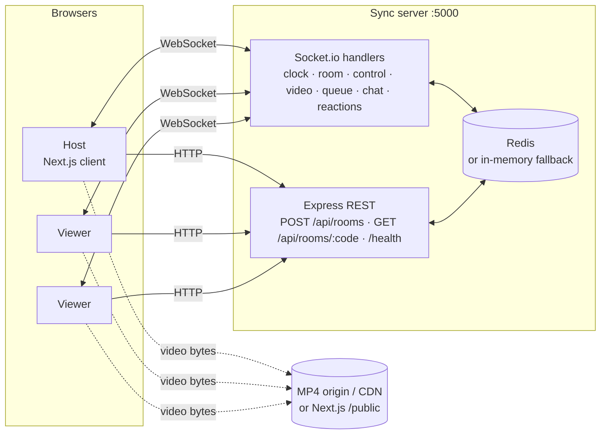

# FRAME Watch Party

Real-time synchronized watch parties: one host controls playback and everyone in the room sees the same
frame. It uses NTP-style clock sync, anchor-based playback, dual-tier drift correction, a shared queue,
live chat and floating emoji reactions.

| | |
|---|---|
| **Sync quality** | p95 control latency **≤ 111 ms** on an emulated WAN (40 ± 10 ms each way), drift **≤ 9.3 ms**, clock precision **± 6 ms**, 100 % delivery at 10–100 users. See [`PERFORMANCE_REPORT.md`](./PERFORMANCE_REPORT.md) |
| **Branch** | `i_am_still_trying` |

---

## Contents

1. [Tech stack](#1-tech-stack)
2. [System architecture](#2-system-architecture)
3. [Quick start](#3-quick-start)
4. [Multi-laptop testing](#4-multi-laptop-testing-lan)
5. [Reviewer walkthrough](#5-reviewer-walkthrough)
6. [Tests & benchmark suite](#6-tests--benchmark-suite)
7. [Configuration](#7-configuration)
8. [Project structure](#8-project-structure)
9. [Future cloud deployment roadmap](#9-future-cloud-deployment-roadmap)
10. [Known limitations](#10-known-limitations)

---

## 1. Tech stack

| Layer | Technology |
|---|---|
| Frontend | **Next.js 14** (App Router), React 18, **Tailwind CSS 3** (cinema dark theme: `#0B0F19` / `#111827` / `#6366F1`, glassmorphism), Lucide icons, **Fuse.js** fuzzy search |
| Realtime | **Socket.io 4** (WebSocket transport, polling fallback) |
| Backend | **Node.js** (ES modules), **Express 4** |
| State | **Redis** via `ioredis`, with automatic fallback to an **in-memory** store (`ioredis-mock`) when Redis isn't running |
| Media | Plain HTML5 `<video>` with progressive MP4. The catalog plays **local files** from `client/public/` (`/sample.mp4` … `/sample4.mp4`), so it works offline |
| Tooling | Node test scripts, a load-testing and benchmark suite (`npm run benchmark`), and an in-process WAN latency emulator |

## 2. System architecture



**How sync works, briefly** (full detail, with formulas, in the [performance report](./PERFORMANCE_REPORT.md#2-synchronization-architecture)):

1. **Clock sync:** each client runs `SYNC_CLOCK` exchanges and computes the offset to the server
   clock: $\theta = ((t_1-t_0)+(t_2-t_3))/2$, smoothed with an EMA (α = 0.25, jitter-gated).
2. **Anchors, not positions:** the host's PLAY / PAUSE / SEEK is stored and broadcast as
   `{ mediaTime, targetTimestamp (server clock), playbackRate, playbackState }`. Every client computes
   `M_expected = mediaTime + (Date.now() + θ − targetTimestamp) / 1000 × rate`, so network latency
   doesn't turn into drift.
3. **Drift correction**, every 3 s on viewers: |drift| < 100 ms → 1.00×, 100–500 ms → 1.05× / 0.95×,
   > 500 ms → hard seek, with a learned seek lead.
4. **Host heartbeat**, every 3 s: re-anchors the room to the host's real position and is relayed to
   viewers as `STATE_SYNC`.
5. **Late joiners** get a full snapshot in `ROOM_JOINED`: anchor, expected position, queue, participants and chat history.
6. **Host failover:** when the host leaves, the longest-connected participant is promoted.

Socket events: `SYNC_CLOCK`, `JOIN_ROOM` → `ROOM_JOINED` / `ROOM_ERROR`, `CONTROL_ACTION` →
`CONTROL_ACTION_BROADCAST`, `HEARTBEAT` → `STATE_SYNC`, `CHANGE_VIDEO` → `VIDEO_CHANGED`,
`UPDATE_QUEUE` → `QUEUE_UPDATED`, `SEND_MESSAGE` → `NEW_MESSAGE`, `EMIT_REACTION` → `REACTION_BROADCAST`,
`CHANGE_PLAYBACK_RATE` → `PLAYBACK_RATE_CHANGED`, `USER_JOINED`, `USER_LEFT`, `HOST_CHANGED`. Payloads are documented in [`server/README.md`](./server/README.md).

## 3. Quick start

**Prerequisites:** Node.js **18.17+** (tested on 22) and npm. Redis 6+ is optional: without it the
server falls back to an in-memory store automatically.

```bash
git clone https://github.com/R-Br-ok/actual_vin_work.git
cd actual_vin_work
git checkout i_am_still_trying
```

**Terminal 1: sync server** (Express + Socket.io on `0.0.0.0:5000`)

```bash
cd server
npm install
cp .env.example .env        # optional; defaults work
# optional: redis-server &  (otherwise the in-memory fallback is used)
npm run dev
```

You should see `Sync Server listening on http://0.0.0.0:5000`, followed by the `Local:` and `Network:` URLs.

**Terminal 2: web client** (Next.js on `0.0.0.0:3000`)

```bash
cd client
npm install
npm run dev                 # = next dev -H 0.0.0.0 -p 3000
```

Open **http://localhost:3000**, enter a name and click **Start watch party**. In the room, click
**Copy link** and open it in a second browser window, or on a second laptop (next section).

Production build: `cd client && npm run build && npm start`.

## 4. Multi-laptop testing (LAN)

Both processes bind to **`0.0.0.0`**, so other devices on the same network can reach them:

- server: `httpServer.listen(5000, '0.0.0.0')` in `server/src/server.js`
- client: `next dev -H 0.0.0.0 -p 3000` in `client/package.json`

1. On the machine running both servers, note the **`Network:`** address the sync server prints (for example
   `http://192.168.1.20:5000`), or find it with `ipconfig` / `ip addr`.
2. On that machine, open **`http://192.168.1.20:3000`**, not `localhost`. That way the invite link you copy
   contains the LAN address.
3. On every other laptop or phone, open the copied link (`http://192.168.1.20:3000/room/ABC123`).
4. The client connects to the sync server on the **same host the page was loaded from**, port 5000, so no
   configuration is needed. To point it elsewhere, set `NEXT_PUBLIC_SOCKET_URL=http://host:5000` in
   `client/.env.local`.

Troubleshooting:

| Symptom | Fix |
|---|---|
| "Can't reach the sync server" | Allow inbound TCP **3000** and **5000** through the host's firewall (Windows Defender, macOS firewall, `ufw allow 3000,5000/tcp`) |
| "Join the watch party" overlay | Browser autoplay policy: click once. Playback then follows the host |
| Copy-link button does nothing | Plain-`http` LAN pages aren't a "secure context". The fallback copy should still work; if not, copy the URL bar |
| "Room Not Found" after restarting the server | The in-memory store was wiped. Create a new room, or run Redis so rooms survive restarts |

## 5. Reviewer walkthrough

| Check | How |
|---|---|
| Synchronized playback | Host presses play, pause or seek (scrubber, or ← / → keys on the focused player). Viewers follow within a few tens of ms |
| Drift correction | On a viewer, open DevTools and run `document.querySelector('video').currentTime += 2`. Within 3 s the telemetry pill shows a hard seek, then *Catching up 1.05×*, then *Aligned* |
| Telemetry | Pill at the top right of the video shows RTT, drift and playback rate. Click it for offset θ and expected vs actual position |
| Late join | Open the link in a third window mid-movie. It lands on the right frame and gets the queue and chat history |
| Video switching | Host clicks **Browse Movies**, then **Play now**: every client switches source and starts together |
| Shared queue | Anyone clicks **Queue** in the catalog or adds a link. All participants see the identical list. The host can reorder, play or remove; the next item auto-plays at the end |
| Fuzzy search | In **Browse Movies**, type `forrest` or `sunet` (typos are fine) |
| Playback speed | Host: the **1×** button in the player controls → 0.5×–2×. Every viewer switches speed and stays in sync; drift nudges become base × 1.05 / 0.95 |
| Unique names | Open the room in two tabs of the same browser plus an incognito window: each gets its own handle (e.g. `Cyber_Viewer_89`, `User_4821`), kept across refresh |
| Landing showcase | The home page hero rotates through the catalog every 6 s with crossfading backdrops; click a slide to jump |
| Chat & reactions | Messages and emoji appear for everyone, including the sender ("You") and the host |
| Room validation | Open `http://localhost:3000/room/NOPE42`. You get the **Room Not Found** card, and no socket is opened |
| Host failover | Close the host's tab. The longest-connected viewer becomes host |

## 6. Tests & benchmark suite

```bash
cd server
npm test            # logic, in-memory CRUD, broadcast, and video/queue/late-join/room-validation suites
```

### Benchmark (`server/scripts/loadTest.js`)

Simulates 10–50+ concurrent participants against a running server. Each virtual client gets a random
clock skew, runs the 3-way NTP sync and EMA, and the host fires periodic PLAY / PAUSE / SEEK actions. The
script measures **RTT**, **control propagation latency** (host emit → viewer receipt), **estimated playback
drift** and **clock-offset error**, reports **min / avg / p50 / p90 / p95 / p99 / max**, and prints a
pass/fail summary against the targets.

```bash
cd server
npm run dev                                   # in one terminal
npm run benchmark                             # in another: 10 and 50 participants
node scripts/loadTest.js --clients 10,25,50,100 --rounds 40
node scripts/loadTest.js --latency 40 --jitter 10       # emulate a WAN (+40 ± 10 ms each way)
node scripts/loadTest.js --url http://192.168.1.20:5000 # benchmark a server on another machine
node scripts/loadTest.js --json results.json            # save raw results
```

| Flag | Default | Meaning |
|---|---|---|
| `--url` | `http://localhost:5000` | Sync server |
| `--clients` | `10,50` | Comma-separated scenario sizes (host + viewers) |
| `--rounds` / `--interval` | `30` / `300` ms | Number and spacing of host control actions |
| `--sync-samples` | `8` | `SYNC_CLOCK` exchanges per client |
| `--skew` | `250` ms | Max simulated client clock offset (±) |
| `--latency` / `--jitter` | `0` / `0` ms | One-way delay + Gaussian jitter via in-process proxy |
| `--json` | — | Write raw results to a file |

Example summary (emulated WAN, in-memory store):

```
■ Summary vs targets
┌────────────────────────────┬──────────┬───────────┬───────────┬────────┐
│ Metric                     │   Target │  10 users │  50 users │ Status │
├────────────────────────────┼──────────┼───────────┼───────────┼────────┤
│ p50 control latency        │ < 100 ms │  86.98 ms │  84.51 ms │ PASSED │
│ p95 control latency        │ < 250 ms │ 108.88 ms │ 106.75 ms │ PASSED │
│ Max playback drift         │ < 500 ms │   5.87 ms │   7.01 ms │ PASSED │
│ Clock sync precision (p95) │  ± 10 ms │   5.24 ms │   6.07 ms │ PASSED │
│ Broadcast delivery         │    100 % │    100.0% │    100.0% │ PASSED │
└────────────────────────────┴──────────┴───────────┴───────────┴────────┘
```

The exit code is non-zero if any target fails. Full results, methodology and analysis are in
[`PERFORMANCE_REPORT.md`](./PERFORMANCE_REPORT.md).

## 7. Configuration

**Server** (`server/.env`, all optional):

| Variable | Default | |
|---|---|---|
| `HOST` | `0.0.0.0` | Bind address |
| `PORT` | `5000` | HTTP + Socket.io port |
| `REDIS_HOST` / `REDIS_PORT` / `REDIS_PASSWORD` | `127.0.0.1` / `6379` / – | Redis connection (1.5 s probe, then in-memory fallback) |
| `CORS_ORIGIN` | `*` | Comma-separated allowed origins (`*` reflects the request origin) |
| `ROOM_CODE_LENGTH` | `6` | Generated room code length |
| `ROOM_EXPIRY_SECONDS` | `86400` | Room TTL (1 h grace after the last person leaves) |

**Client** (`client/.env.local`, optional):

| Variable | Default | |
|---|---|---|
| `NEXT_PUBLIC_SOCKET_URL` | `http(s)://<page host>:5000` | Override the sync-server URL |
| `NEXT_PUBLIC_SERVER_PORT` | `5000` | Port used when deriving the URL from the page host |

## 8. Project structure

```
.
├── README.md                  ← you are here
├── PERFORMANCE_REPORT.md      ← benchmark results & sync design
├── client/                    Next.js 14 app
│   ├── public/sample*.mp4     local catalog videos (sample.mp4 = room default)
│   ├── public/posters/        poster frames extracted from each clip
│   └── src/
│       ├── app/               / (home) and /room/[code] (validates code → joins)
│       ├── components/        header/, player/ (VideoSyncPlayer, PlayerControls, DriftIndicator,
│       │                      ReactionCanvas), social/ (ChatBox, PlaylistQueue, ReactionBar),
│       │                      discovery/ (MovieDiscoveryModal, MovieCard), room/ (RoomNotFound), ui/
│       ├── context/           SocketContext (singleton), RoomContext (room state + actions)
│       ├── hooks/             useClockSync, useDriftCorrection, useMovieSearch
│       ├── data/mockMovies.js catalog of direct, playable MP4s
│       └── lib/               socket singleton + room validation, constants, utils
└── server/                    Express + Socket.io
    ├── scripts/               loadTest.js (benchmark), latencyProxy.js (WAN emulation)
    ├── src/
    │   ├── server.js          binds 0.0.0.0:5000
    │   ├── routes/            REST: rooms, health
    │   ├── services/          roomService (Redis CRUD, queue, anchors, failover), clockService
    │   └── sockets/handlers/  clock, room, control, heartbeat, video, queue, social, reaction, disconnect
    └── test/                  npm test suites
```

## 9. Future cloud deployment roadmap

| Phase | Work | Why |
|---|---|---|
| **1. Production hardening** | HTTPS/WSS behind a reverse proxy (Caddy / Nginx), managed Redis with persistence, Docker images for client and server, health-checked deploys (Fly.io / Render / ECS) | Secure context (clipboard, autoplay heuristics), durable rooms, repeatable deploys |
| **2. Horizontal scaling** | `@socket.io/redis-adapter` for cross-instance broadcasts, **Redis Cluster** for state, sticky sessions at the load balancer, and replacing the in-process room lock with Redis Lua scripts / `WATCH`-`MULTI` | Rooms spread across many Node instances; atomic queue and anchor updates cluster-wide |
| **3. Media delivery** | HLS/DASH adaptive bitrate via a CDN, signed URLs, and pre-buffer coordination (start PLAY only once all clients report `canplay`, with a timeout) | Smooth playback on slow links; fewer buffering-induced corrections |
| **4. WebRTC** | WebRTC **data channels** for host → viewer control messages (P2P for small rooms), and an **SFU** (mediasoup / LiveKit) for streaming the host's local file, screen or camera | Lower control latency without a server hop; watch content that isn't on a URL |
| **5. NAT traversal** | **STUN + TURN** (coturn, or a managed TURN service) with TURN-over-TLS on 443 | WebRTC that works behind corporate and mobile NATs |
| **6. Global edge** | Regional sync servers with edge-local clock sync, rooms pinned to the host's region, Redis replication across regions | Keep RTT, and therefore NTP asymmetry error, low for globally spread rooms |
| **7. Product & ops** | Auth / room passwords, moderation and rate limits, Prometheus metrics from the client telemetry (drift, RTT, corrections per minute), Grafana alerts, load tests in CI (`npm run benchmark` exits non-zero on regression) | Safety and observability at scale |

## 10. Known limitations

- **In-memory fallback**: rooms are lost on server restart (including nodemon reloads). Use Redis for anything beyond local testing.
- **Single-instance locking**: queue and video changes are serialized per room *within one process*. Multi-instance needs phase 2 above.
- **Autoplay policies**: viewers who open a link directly may need one click ("Join the watch party") before audio plays. Playback starts muted otherwise.
- **Catalog files** live in `client/public/`. To add a title, drop an MP4 there, add a poster under `public/posters/`, and add an entry to `client/src/data/mockMovies.js`.
- **NTP asymmetry**: clock offset error is bounded by half the up/down path asymmetry, which is inherent to any round-trip time sync.
